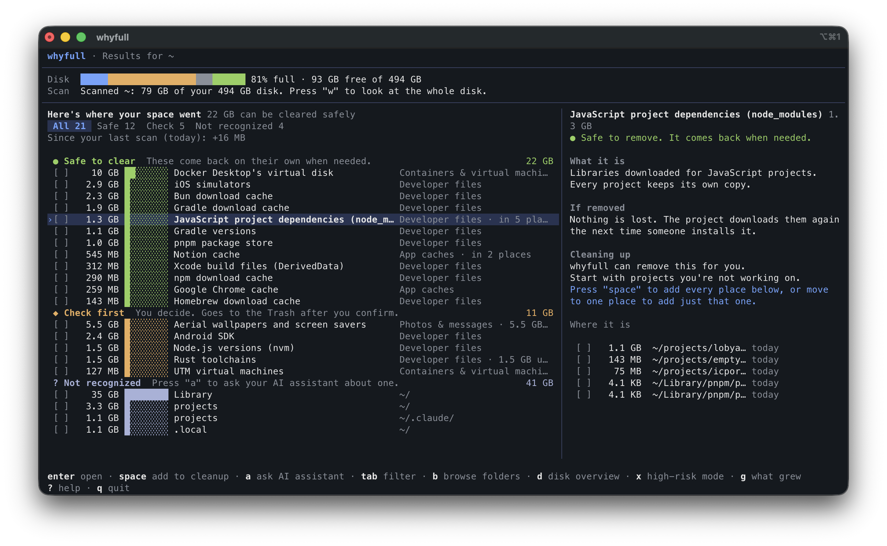

<div align="center">

# whyfull - _Whyyyy full?_ 😵‍💫

**Your disk is full and you don't know why. Find out in plain language, then free space safely.**

It shows what is using your space, says what is safe to remove, and changes nothing until you review and confirm.



</div>

## 📦 Install

You need macOS 15 or later and [Homebrew](https://brew.sh).

```bash
brew install behnamazimi/tap/whyfull
```

Update later with `brew upgrade whyfull`.

No Homebrew? This downloads the latest release, checks its checksum, and installs `whyfull` to `~/.local/bin`:

```bash
curl -fsSL https://raw.githubusercontent.com/behnamazimi/whyfull/main/scripts/install.sh | sh
```

Run it again to update.

## 🚀 Quickstart

```bash
whyfull
whyfull ~/Downloads
whyfull report
```

The first command looks through your home folder, the second through one folder, and the third prints a summary and exits. The bottom line of the screen always shows the keys you can use, and `m` shows the rest. The four tabs at the top (`1` Cleanup, `2` Folders, `3` Disk, `4` What grew) look the same, so you always know where you are. On Cleanup, press `enter` on a group's name to fold it away or open it again.

## ✨ What you can do

- 🔍 **See where it went:** every big space user gets a plain name and a short explanation, so you never have to guess what a folder is for.
- 🛟 **Clean up with a safety net:** pick what to remove (press `space` on a group's name to pick all of it, or `s` to pick everything safe), review the plan, then confirm. Caches that apps rebuild are deleted. Your own files go to the Trash, where you can still change your mind.
- 📣 **Share what you freed:** after a cleanup, press `S` (Shift+S) to copy a short summary you can paste anywhere.
- 📈 **Catch what's growing:** open the What grew tab (`4`) to see what has grown since your last scan.
- 🌍 **Look at everything:** press `w` to scan the whole disk, or start with `whyfull --whole-disk`.
- 🤖 **Script it:** run `whyfull report --json` to get the same summary as JSON.

## 📝 Notes

- 🔒 Nothing leaves your Mac. whyfull has no network code.
- ⚠️ whyfull only cleans what it recognizes. For anything else, high-risk mode (`x`) lets you delete files in your home folder yourself. They are deleted for good, so you confirm by typing `delete`.

## 🤝 Help it learn more

Something big on your disk shows up as "Not recognized"? Run `whyfull report --json`, remove anything private, and [share it](https://github.com/behnamazimi/whyfull/issues/new?template=share-report.yml). whyfull never sends anything on its own, so you paste it yourself. Reports decide which space users get explained next. To add one yourself, see [CONTRIBUTING.md](CONTRIBUTING.md).

## 📄 License

[MIT](LICENSE)
